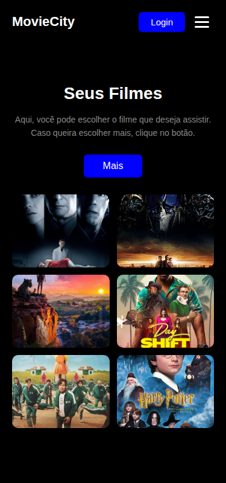

# 🎬 MovieCity — Landing Page

Landing page responsiva de um serviço de streaming fictício, construída com **React + Vite** e **CSS puro**. Projeto de prática de componentização, estruturação de pastas, carregamento de imagens e responsividade.


## 📸 Preview

| Desktop | Mobile | Mobile (menu aberto) |
|---|---|---|
|  |  |  |

## 🎯 O que o projeto faz

- **Header:** logo "MovieCity", menu de navegação (Filmes, Categoria, Sobre, Contato) e botão **Login**.
- **Main:** coluna com o texto de chamada ("Seus Filmes") + botão **Mais**, e coluna com um grid de 6 cards de filmes (Afterlife, Transformers, Mowgli, Shift, Round 6 e Harry Potter).
- **Mobile:** as colunas se empilham, o grid passa para 2 colunas e o menu vira um **hambúrguer** que abre e fecha.

## 🧰 Tecnologias

React 19 · Vite · JavaScript (ESM) · CSS puro (media queries, Flexbox e Grid) · oxlint

## ✅ Pré-requisitos

- Node.js 20.19+ ou 22.12+
- npm

## ▶️ Como executar

```bash
npm install
npm run dev
```

Abra http://localhost:5173.

| Comando | Descrição |
|---|---|
| `npm run dev` | Servidor de desenvolvimento com HMR |
| `npm run build` | Build de produção em `dist/` |
| `npm run preview` | Pré-visualiza o build |
| `npm run lint` | Análise estática do código |

## 📁 Estrutura de pastas

```
01_landinpage/
├── public/
│   └── favicon.svg
├── src/
│   ├── assets/            # imagens dos pôsteres
│   ├── components/
│   │   ├── Header.jsx     # cabeçalho + menu hambúrguer
│   │   ├── Main.jsx       # texto de chamada + grid de filmes
│   │   └── Home.jsx       # container da página
│   ├── App.jsx            # renderiza <Home />
│   ├── index.css          # estilos globais + responsividade
│   └── main.jsx           # ponto de entrada do React
├── index.html
├── package.json
└── vite.config.js
```

Fluxo: `index.html → main.jsx → App.jsx → Home.jsx → Header.jsx + Main.jsx`

## 📱 Responsividade

| Breakpoint | Alvo | O que muda |
|---|---|---|
| `max-width: 1100px` | Tablets em paisagem | Espaçamentos e tipografia menores |
| `max-width: 900px` | Tablets retrato / celulares grandes | Colunas empilham, texto centralizado, menu hambúrguer |
| `max-width: 600px` | Celulares | Grid de cards com 2 colunas |
| `max-width: 380px` | Celulares pequenos | Ajustes finos de fonte e proporção dos cards |

Testado em 1568, 1024, 768, 600 e 375px, sem barra de rolagem horizontal.

## 🧪 Testes realizados

- [x] `npm run dev` / `npm run build` executam sem erros
- [x] Visual conferido contra o print do resultado esperado
- [x] Responsividade nas larguras acima
- [x] Menu hambúrguer abre/fecha e fecha ao clicar em um link

## 💡 Próximos passos

- Transformar os cards em botões acessíveis
- Adicionar título e nota por filme
- Buscar filmes de uma API (ex.: TMDB) e renderizar com `.map()`
